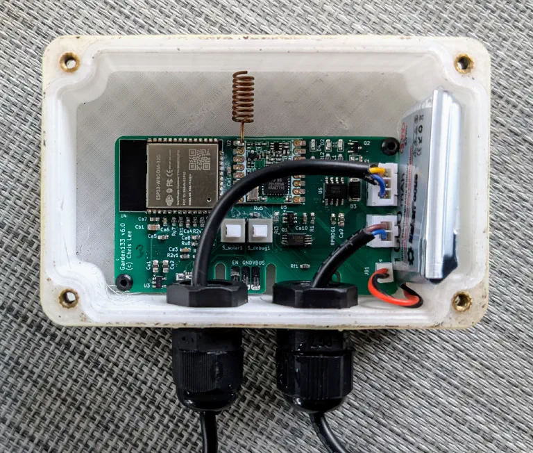
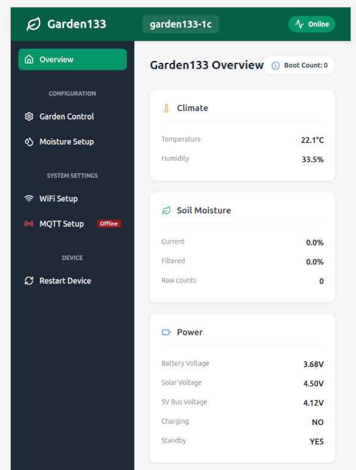
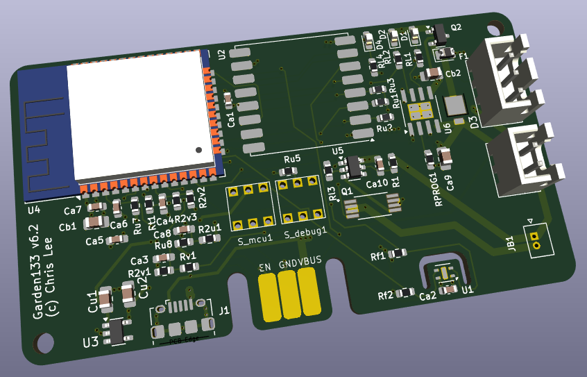

# Garden133 (v1.1.0)

Garden133 is a solar and battery-powered device for monitoring garden soil moisture levels.
It reads the moisture level of soil using a capacitive moisture sensor and transmits data via LoRa.

Please see the [Introducing Garden133](https://selectiveappeal.org/posts/garden133/) blog
post for a project overview.



## Features
- **Modern Web Interface:** A responsive Svelte-based UI for real-time status monitoring and calibration (accessible in Debug Mode).
- **Soil Moisture Sensing:** Capacitive sensor measurement with high-precision calibration and low-voltage filtering protection.
- **Dedicated Calibration Page:** View live ADC counts to precisely tune dry/wet thresholds.
- **Device Environmental Monitoring:** SHTC3 sensor for air temperature and humidity inside the device enclosure.
- **Power Management:** Solar charging, battery/5V rail monitoring, TP4056 charge/standby status reporting (Board v6+), and P-MOSFET moisture sensor power gating during deep sleep (Board v7+).
- **LoRa Communication:** Supports both HopeRF RFM95W (`SX1276`, Board v5–v7) and Ai-Thinker Ra-01SH (`SX1262`, Board v8+) modules to connect to a base station ([LoRa133](https://github.com/chl33/LoRa133)) for Home Assistant integration.
- **OTA Updates:** Support for wireless firmware updates.



## Hardware
This project includes the custom hardware design and 3D printable parts.

- **PCB Design:** KiCAD files are available in [`KiCAD/Garden133/`](KiCAD/Garden133/).
  - **Board v6.x:** Adds TP4056 charge/standby status inputs.
  - **Board v7.0:** Adds P-channel MOSFET (`AO3401A` on GPIO25) to power off the capacitive moisture sensor during sleep.
  - **Board v8.0:** Transitions to the Ai-Thinker Ra-01SH (`SX1262`) LoRa transceiver and an active-low debug DIP switch with external pull-up.
  
- **Enclosure & Fixtures:** OpenSCAD files for the waterproof enclosure, desiccant inserts, mounts, and solder-paste stencil fixtures are in [`OpenSCAD/`](OpenSCAD/).

## Firmware Dependencies
This firmware uses the [PlatformIO](https://platformio.org/) build system and depends on the following libraries:
- [og3](https://github.com/chl33/og3): Base C++ library for ESP32/Arduino.
- [og3x-lora](https://github.com/chl33/og3x-lora): LoRa module support (`SX1276` and `SX1262` via RadioLib).
- [og3x-satellite](https://github.com/chl33/og3x-satellite): Satellite architecture support.
- [og3x-shtc3](https://github.com/chl33/og3x-shtc3): SHTC3 temperature and humidity sensor support.

## Getting Started

### Prerequisites
- [PlatformIO Core](https://docs.platformio.org/en/latest/core/index.html) or VSCode with PlatformIO extension.
- Node.js (v22+) and `npm` (for building the embedded Svelte web UI).
- An ESP32-based Garden133 board.

### Configuration
The project uses `secrets.ini` and `local.ini` for local configuration and board definitions (both excluded from git):

1. **Setup Secrets & Local Board Environments:**
   Copy the example configuration files:
   ```bash
   cp secrets.ini.example secrets.ini
   cp local.ini.example local.ini
   ```
   - Edit `secrets.ini` to set `otaPassword` for Over-The-Air updates.
   - Edit `local.ini` to configure your board's `HARDWARE_VERSION_MAJOR` / `HARDWARE_VERSION_MINOR` (e.g., `6.2`, `7.0`, or `8.0`), upload port/IP, and optional UDP debug logging.

### Building & Flashing

1. **Build the firmware:**
   ```bash
   pio run
   ```

2. **Upload the firmware:**
   ```bash
   pio run --target upload
   ```

3. **Upload Filesystem (LittleFS):**
   This uploads the `data/` directory containing web resources.
   ```bash
   pio run --target uploadfs
   ```

## License
This project is licensed under the MIT License. See `LICENSE` for details.
